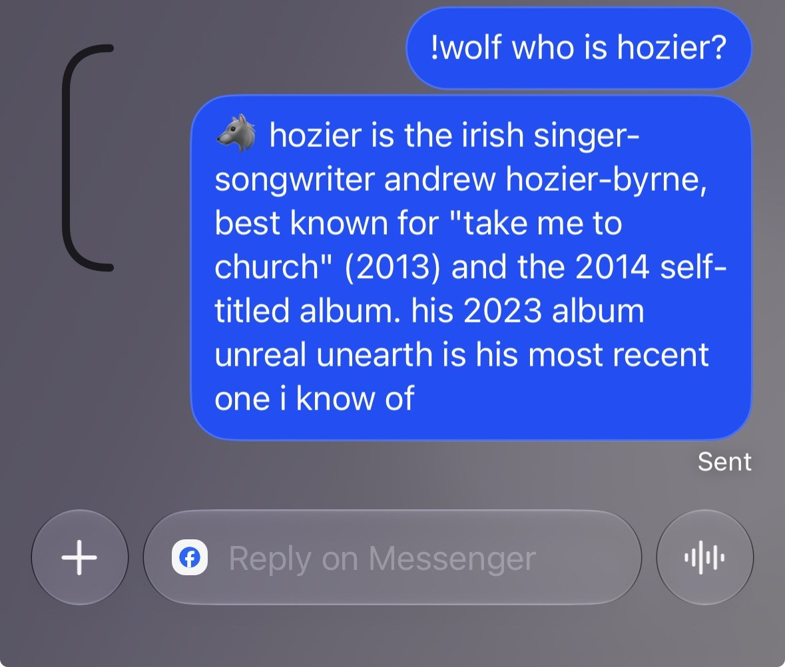

# Beeper platform for Hermes Agent

A [Hermes Agent](https://github.com/NousResearch/hermes-agent) gateway platform that brings Hermes into your own chats through the local [Beeper Desktop API](https://developers.beeper.com/desktop-api). Type a trigger in a chat that you allowed, and Hermes answers there. It works on every network that Beeper Desktop connects: WhatsApp, Signal, Telegram, LINE, iMessage, Instagram, Messenger, Discord, Slack and more.

Replies are posted **from your own account**, with a marker (🤖 by default) so that people can tell the agent from you.



An example setup: a Messenger group with the trigger set to `!wolf` and the reply marker set to 🐺. The trigger, the marker and the agent's persona are all yours to choose.

## Disclosure

Read this before you install:

- The plugin connects to the Beeper Desktop API on your machine (`http://127.0.0.1:23373` by default) with your access token. It makes no other network calls. The agent itself uses your configured model provider and tools as usual.
- It reads messages only from the chats that you list in `config.yaml`. The WebSocket subscription is limited to those chat IDs.
- It sends messages, and optionally reactions, **as you**, only in the chats that you list.
- It writes two files under your Hermes home: `beeper/chat-cursors.json` (the last handled message per chat) and, in dry-run mode, `beeper/dry-run.jsonl` (the replies it would have sent). Both are owner-only (mode 600).
- When a message that wakes the agent has photos, it downloads them from the Desktop API into Hermes' image cache (`cache/images/` under your Hermes home, folder mode 700, files mode 600), so the agent can see them. Turn this off with `download_images: false`.
- It never marks chats as read and never sends typing indicators. Replying or reacting on some networks can still mark a chat as read on your side. That is the network's behavior.
- No telemetry.

## Requirements

- Hermes Agent 0.23.3 or newer.
- Beeper Desktop with the Desktop API enabled, and an access token from Beeper Desktop → Settings → Developers.

## Install

```bash
hermes plugins install beeper-platform        # from the Hermes plugin catalog
# or straight from GitHub:
hermes plugins install clins1994/hermes-beeper
hermes plugins enable beeper-platform
```

Put the token in your profile's `.env`:

```bash
BEEPER_ACCESS_TOKEN=...
```

## Configure

Nothing is active until you list a chat. Use a chat ID (`!abc...:beeper.local`) or the local chat ID that Beeper Desktop shows. `GET /v1/chats` and `GET /v1/chats/search?query=...` on the Desktop API list both.

```yaml
# config.yaml
gateway:
  platforms:
    beeper:
      enabled: true
      dry_run: true              # first run: write replies to beeper/dry-run.jsonl, send nothing
      trigger: "!hermes"         # messages must start with this word
      reply_marker: "🤖 "        # added to every reply, cannot be empty
      processing_reaction: ""    # for example "👀" on the triggering message while the agent works
      download_images: true      # pass photos to the agent as files (default true)
      max_image_mb: 20           # skip photos larger than this (default 20)
      chats:
        "101":                   # your notes-to-self chat
          label: notes           # used in logs only
        "!abc123:beeper.local":  # a group with friends
          label: friends
          invokers: ["*"]        # anyone in this chat can use the trigger (default: only you)
          toolsets: [search]     # tools for this chat only
platform_toolsets:
  beeper: [search]               # tools for every Beeper chat
```

Per-chat settings:

| Key | Default | Meaning |
|---|---|---|
| `mode` | `prefix` | `prefix`: only messages that start with the trigger. `always`: every message from an allowed sender. Use `always` only for a chat that only you are in. |
| `trigger` | the global trigger | A different trigger word for this chat. |
| `invokers` | `[self]` | Who can trigger the agent: `self`, sender IDs such as `@whatsapp_123:beeper.local`, or `*`. |
| `toolsets` | the platform toolsets | Toolsets for this chat only. |
| `processing_reaction` | the global value | A different reaction for this chat, or `""` to turn it off. |

Global settings: `base_url` (default `http://127.0.0.1:23373`), `max_backfill_age_seconds` (default 600), `download_images` (default `true`), `max_image_mb` (default 20), and `rate_limit` with `per_chat_seconds` (2), `global_per_minute` (20), `breaker_replies` (10) and `breaker_window_seconds` (600).

## Photos

When a message wakes the agent and has photos, the plugin downloads each photo with `GET /v1/assets/serve` and passes it to Hermes as a local file. Hermes then attaches it to the turn for a model with vision, or describes it with `vision_analyze` for a model without. The agent also gets the file path, so it can copy the photo, for example into a repository.

- In a `mode: always` chat, a photo with no text wakes the agent.
- In a `prefix` chat, the caption must start with the trigger, for example a photo captioned `!hermes use this for the post`.
- Only images are downloaded. Stickers, videos, voice notes and other files still show as a placeholder such as `[attachment: video]`.
- A photo larger than `max_image_mb`, a download that fails, or a file that is not an image falls back to the placeholder `[attachment: image]`, and the log has a warning.
- File names from the chat are never used for paths. Each photo gets a random name in the cache. Hermes deletes cached files after about 24 hours, so the agent should copy a photo that it needs to keep.

Start the gateway with `hermes gateway run`. Run it in dry-run first, read `beeper/dry-run.jsonl`, then set `dry_run: false`.

## How it stays safe in your own account

The agent posts as you, so its own replies come back as new messages. The plugin drops a message in these cases:

- Its ID matches a message that the plugin sent.
- It is your message and it starts with the reply marker.
- The plugin already handled it. One message is upserted several times (pending, sent, seen).
- It is older than the chat cursor. The API also upserts old messages when someone reads or edits them.
- It is a reaction, a notice or an unknown message type.
- The chat reached the reply limit (`breaker_replies` in `breaker_window_seconds`). The chat then pauses.

Other protections:

- **Allowlist only.** The plugin refuses to send to a chat that is not listed.
- **No pairing codes.** Hermes normally answers unknown senders with a pairing code. On Beeper that code goes out from your account, so the plugin turns it off.
- **No gateway notices in chats.** Setup and status notices (for example "No home channel is set") go to the log, not into a chat.
- **Owner-only slash commands.** Only you can run commands such as `/model` or `/new`. Other people keep `/help` and `/whoami`.

For chats with friends, use a separate Hermes profile with memory off and a small toolset, for example `[search]`, and give the agent a persona (`SOUL.md`) that tells it not to speak for you.

## Reliability

The Desktop API WebSocket is documented as at-most-once, with no replay after a reconnect, and its `seq` counts per connection. The plugin:

- reconnects with backoff (1 s to 30 s),
- catches up every listed chat over REST from the saved cursor after each connect and after a `seq` gap,
- skips caught-up triggers older than `max_backfill_age_seconds`, so it does not answer stale requests after downtime,
- starts from the newest message the first time it sees a chat, so it never answers history.

## Limits

- Text and photos in, text out, and replies. Other incoming media (videos, voice notes, files, stickers) shows to the agent as a placeholder such as `[attachment: video]`. The agent cannot send files yet.
- The Desktop API must run on the same machine as Hermes, or be reachable through `base_url`.

## Development

The tests need a hermes-agent checkout and its Python environment:

```bash
HERMES_AGENT_REPO=~/path/to/hermes-agent ~/path/to/hermes-agent/.venv/bin/python -m pytest tests
```

`tests/fixtures/` holds a recorded WebSocket session and a REST page from Beeper Desktop 4.3.22. They are anonymized: IDs and times are renumbered, and every text and name is replaced.

## License

MIT
